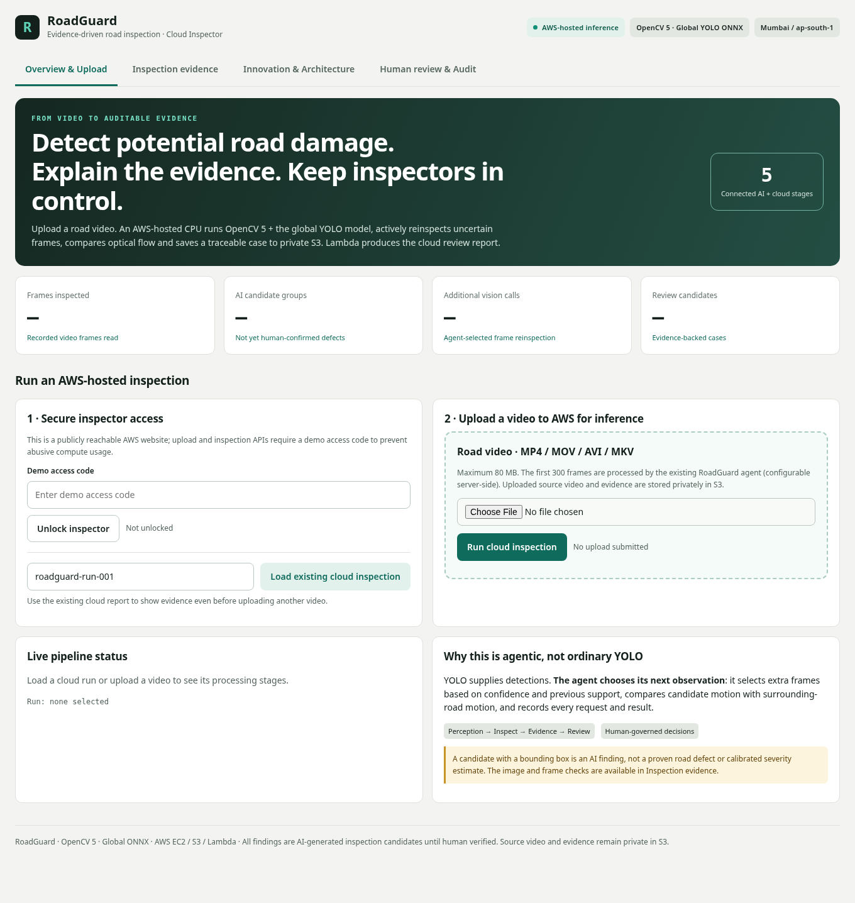
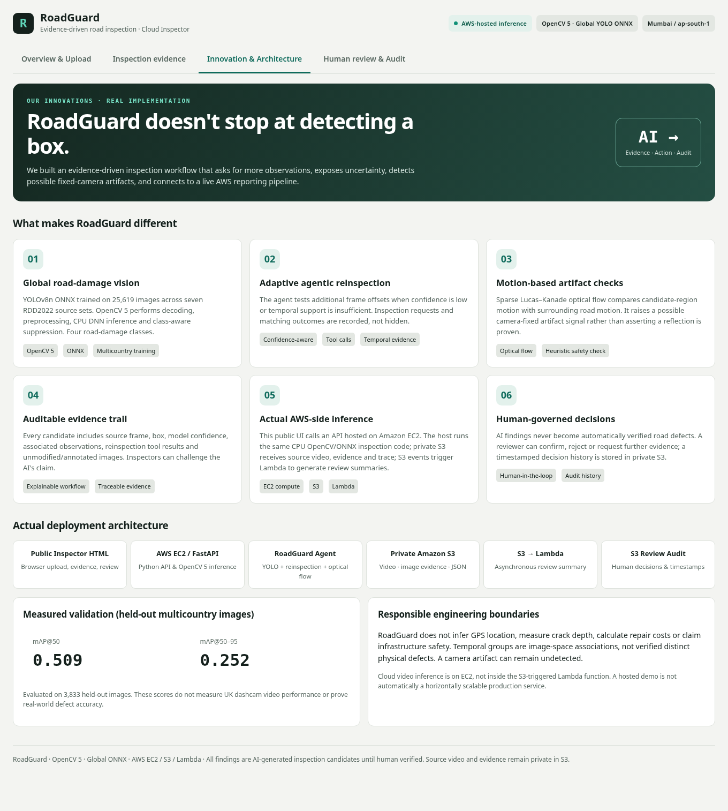
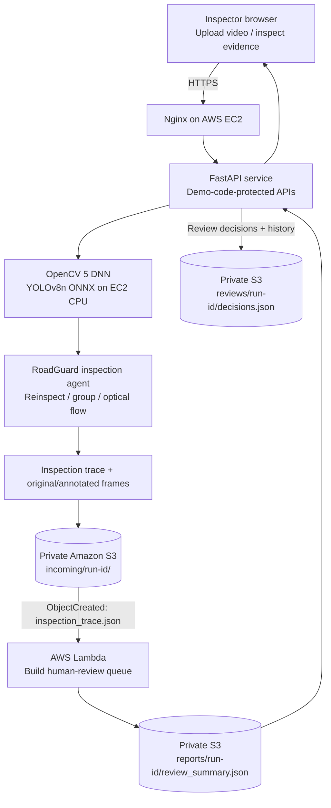

# RoadGuard — Evidence-Driven Road Damage Inspection with OpenCV 5 and AWS

**An agentic, human-in-the-loop road inspection system that turns driving video into reviewable evidence, not automatic repair decisions.**

RoadGuard uses **OpenCV 5 DNN** to run a multi-country **YOLOv8n ONNX** road-damage detector, then performs confidence-aware frame reinspection, tentative observation grouping and sparse optical-flow checks. An AWS-hosted inspector dashboard lets a reviewer examine original/annotated frames, see the agent's evidence, and record a decision. **Predictions are candidates for human review, not verified road defects.**

**Live inspector:** https://13-204-218-48.sslip.io/  
**AWS region:** Asia Pacific (Mumbai), `ap-south-1`  
**Submission branch:** `roadguard-competition-final`  
**Demo video (five minutes or less):** Add the public/unlisted video URL here before submitting.  
**Judge access:** find this demo access code in the section called project details under **"Try it out" links** in the project submission. 




## 1. The problem and who it serves

Road inspections are time-consuming, and an individual video can contain repeated views of the same candidate crack, shadows, windshield artifacts and uncertain predictions. A detection-only system offers boxes but little context for a reviewer.

RoadGuard is designed as a **decision-support prototype** for road-maintenance inspection teams, municipal infrastructure teams and researchers. It helps turn candidate observations from recorded video into traceable, prioritized human review items. It does **not** assess structural integrity, calculate repair urgency or automate road-maintenance decisions.

## 2. What makes RoadGuard different

1. **OpenCV 5 inference on AWS CPU:** `cv2.dnn.readNetFromONNX` executes the exported YOLOv8n model on an EC2 instance; Lambda is *not* used for vision inference.
2. **Evidence-driven agent:** Samples frames, tentatively groups overlapping observations, requests additional frame inferences and records an inspection trace.
3. **Motion-context checks:** OpenCV Lucas–Kanade sparse optical flow compares a candidate region with its surroundings. This is a weak artifact signal, **not proof** of a windshield reflection or a real defect.
4. **Uncertainty-preserving review:** Candidate and uncertain events remain visible for human verification rather than being silently accepted or rejected.
5. **Auditable AWS handoff:** Original/annotated evidence and a JSON trace are stored in private S3; an S3-triggered Lambda produces an ordered review queue; reviewer decisions and history are written back to S3.



## 3. End-to-end architecture



**Implementation details:** EC2 runs Ubuntu 24.04 and hosts Nginx, one Uvicorn/FastAPI worker, OpenCV 5 and the ONNX model. HTTPS terminates at Nginx; the FastAPI process listens on `127.0.0.1:8000`. S3 is private. Lambda handles asynchronous report generation, **not detection**. This prototype does not use AWS Graviton or the COOL library.

**Processing sequence:** upload video → validate/limit file size → analyze at most 300 frames (initial stride 5) → generate evidence/trace → upload video and images to S3 → upload `inspection_trace.json` **last** to trigger Lambda → retrieve summary → allow human review.

## 4. Detection model and evaluation

**Dataset:** RDD2022 annotations consolidated across seven country/viewpoint folders (India, Japan, Czech, Norway, United States, China MotorBike and China Drone). The prepared dataset contains **25,619 images** and **55,230 retained bounding-box annotations**. Dataset preparation and class mapping are implemented under `scripts/data_preparation/`.

| RoadGuard class | Source labels |
| --- | --- |
| Longitudinal crack | `D00`, `D01` |
| Transverse crack | `D10`, `D11` |
| Alligator crack | `D20` |
| Other road damage | `D40` |

**Held-out multi-country image test (3,833 images):**

| Metric | Result |
| --- | ---: |
| Precision | **0.5857** |
| Recall | **0.4815** |
| mAP@0.50 | **0.5092** |
| mAP@0.50:0.95 | **0.2518** |

These are **image-detector evaluation metrics**, not end-to-end road-video inspection accuracy or real-world repair-identification rates. The ONNX detector uses a four-class YOLOv8n output; the exported model is at `models/roadguard_global_yolov8n.onnx`.

**Agent test evidence:** In one recorded local inspection, RoadGuard read 300 frames, initially sampled 60, produced 25 detection observations, tentatively grouped them into 10 candidates and requested 44 additional frame inferences. It generated 10 review events (4 candidate-for-review, 2 possible-artifact reviews and 4 insufficient-evidence reviews). These are **observed workflow counts**, not validated physical defects.

**AWS review example:** The dashboard has successfully loaded the existing `roadguard-run-001` S3/Lambda review summary containing **six candidate events** (four flagged for human review and two requiring more evidence), with supporting images. This proves that the stored review workflow can be displayed; it should **not** be mistaken for independent validation of a fresh browser-upload inference run.

## 5. Repository layout

```text
RoadGuard/
├── backend/main.py                       # FastAPI upload, jobs, evidence and review APIs
├── frontend/index.html                  # Inspector dashboard
├── models/roadguard_global_yolov8n.onnx # Exported four-class detector
├── roadguard_agent.py                   # Multi-step inspection agent
├── opencv_detector.py                   # OpenCV DNN preprocessing/postprocessing
├── video_detector.py                    # Basic video detection workflow
├── lambda_roadguard_report.py           # S3-triggered review summary generator
├── deploy/                               # systemd, Nginx and IAM policy examples
├── scripts/
│   ├── data_preparation/                 # RDD2022 and multi-country preparation
│   ├── evaluation/                       # Model/data validation utilities
│   ├── visualization/                    # Label and prediction visualizations
│   └── aws/                              # Evidence packaging and upload utilities
├── tests/test_backend.py                # Offline mocked-S3 API tests
├── docs/images/                          # Dashboard screenshots
├── README_DEPLOY.md                     # AWS provisioning and operation guide
├── requirements_public.txt              # Hosted API/runtime dependency constraints
├── pyproject.toml                        # Local Python project metadata
└── uv.lock                               # Local-project dependency lock
```

Generated videos, model-training datasets, runtime jobs, inspection evidence, cloud credentials and `.env` files must not be committed.

## 6. Run the detector and agent locally

**Prerequisites:** Python environment compatible with the project's dependency files; OpenCV **5.x**; model file in `models/`; and a lawfully obtained road video.

```bash
git clone -b roadguard-competition-final https://github.com/akbundi/OpenCV-AI-Competition-.git roadguard
cd roadguard
python -m venv .venv
# Linux/macOS:
source .venv/bin/activate
# Windows PowerShell instead: .\.venv\Scripts\Activate.ps1
python -m pip install -r requirements_public.txt
python -c "import cv2; print(cv2.__version__)"
python test_onnx.py
```

Place a test recording at `data/videos/road_sample.mp4` (create the directory if needed), then run:

```bash
python roadguard_agent.py --video data/videos/road_sample.mp4 --max-frames 300 --stride 5 --output output/agent_global
```

Inspect `output/agent_global/inspection_trace.json` and its `evidence/` images. The tool may return zero candidates for a video with no detectable damage. **Only the first 300 frames are considered with the default frame cap.**

## 7. Run the hosted AWS inspector

Deployment instructions and sample IAM/Nginx/systemd files: **[README_DEPLOY.md](README_DEPLOY.md)** and [`deploy/`](deploy/).

The deployed design uses **EC2 (CPU inference + API + Nginx), private S3 (artifacts/reviews), and S3-triggered Lambda (report generation)** in `ap-south-1`.

On an Ubuntu EC2 host with an authorized S3 instance role, clone the repository, then:

```bash
cd /home/ubuntu/roadguard
python3 -m venv .venv
.venv/bin/python -m pip install --upgrade pip
.venv/bin/pip install -r requirements_public.txt
cp .env.example .env
chmod 600 .env
# Edit .env: set a long random ROADGUARD_DEMO_CODE and your private bucket/region.
sudo cp deploy/roadguard.service /etc/systemd/system/roadguard.service
sudo systemctl daemon-reload
sudo systemctl enable --now roadguard
curl http://127.0.0.1:8000/api/health
```

Configure Nginx and HTTPS as documented in `README_DEPLOY.md`; the API must **not** be publicly exposed on port 8000. The systemd service assumes installation under `/home/ubuntu/roadguard/`. Never publish the `.env` file or access code.

**Dashboard smoke test:**

1. Open the [live inspector](https://13-204-218-48.sslip.io/) and unlock it with the privately provided demo code.
2. Load the existing cloud inspection ID **`roadguard-run-001`** and verify the review queue and image evidence.
3. Upload a permitted MP4/MOV/AVI/MKV video of **80 MiB or less** and select **Run cloud inspection**.
4. Watch the processing stage; check S3 for `incoming/<run-id>/inspection_trace.json` and `reports/<run-id>/review_summary.json`.
5. Review an event and verify `reviews/<run-id>/decisions.json` in S3.

**Known scope:** one inference job at a time; CPU-based inference; a 300-frame cap; asynchronous Lambda processing. A successful existing-run review is verified, but fresh upload-to-report processing and reviewer-write persistence must be demonstrated separately before claiming them as end-to-end tested.

## 8. Tests and reproducibility

**Offline API tests** use a mocked S3 implementation and cover public health/authentication, uploading the trace *last*, loading an existing review summary, fetching evidence and saving a reviewer decision.

```bash
python -m pip install pytest httpx
python -m pytest tests/test_backend.py -q
python -m compileall -q scripts
```

`requirements_public.txt` currently **pins OpenCV 5 exactly** but uses bounded ranges for other hosted packages. `uv.lock` records the locked local-project environment. To meet a strict *fully pinned hosted environment* submission requirement, capture the working EC2 environment and commit a separately reviewed lock file:

```bash
/home/ubuntu/roadguard/.venv/bin/python -m pip freeze > requirements_aws_lock.txt
```

Review the generated file for private package URLs before publishing, and test installation from it on a clean environment. Do not treat the OpenCV version check or mocked-S3 tests as a substitute for a real AWS upload test.

## 9. Limitations, failure modes and responsible use

- **False positives/negatives:** shadows, weather, road markings, motion blur, reflections and unusual road surfaces can mislead the detector; recall is limited on the held-out data.
- **Video-to-world ambiguity:** image-space groups are tentative and do not uniquely count physical cracks. Optical flow cannot reliably prove that an observation is a camera artifact.
- **No severity estimate:** bounding boxes and confidences are not calibrated road measurements, physical crack dimensions or actionable repair priorities.
- **Human oversight:** every candidate requires human judgment; reviewer decisions are auditable but are not automatic infrastructure approvals.
- **Privacy:** use authorized footage; avoid sharing identifiable license plates, faces or sensitive locations. Keep original video, evidence and review objects in private S3 and set an appropriate retention/deletion policy.
- **Operational limits:** current demo-code authentication, one-worker processing, local job state and S3 JSON review updates are not a multi-user production security or concurrency design. Production use would need robust identity, quotas, monitoring, lifecycle management and transactional review storage.
- **Legal and licensing:** verify RDD2022 source-data terms, model/Ultralytics licensing and rights to redistribute weights or footage before publishing assets.

## 10. Submission evidence

The final judge packet should contain a **technical report**, the **OpenCV 5 + AWS architecture diagram**, the **held-out evaluation and failure-case evidence**, a **judge-accessible demonstration**, the **source repository**, and **locked installation/test instructions**. This README provides an overview and architectural diagram; the detailed report and unlisted demo link will be added separately before submission.

---

*RoadGuard is a research/hackathon prototype for assisted visual inspection. Its output is advisory and requires qualified human review.*
