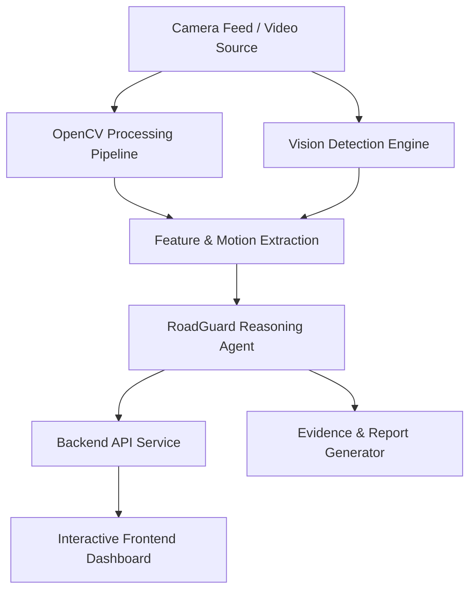

# RoadGuard System Architecture

## Overview
RoadGuard is designed as a modular, high-throughput road intelligence system that converts raw camera video feeds into actionable safety alerts and violation analytics.

## System Components

### 1. Vision Engine (`src/vision/`)
- Object detection (Vehicles, Pedestrians, Cyclists, Debris, Potholes).
- Multi-object tracking across sequential video frames.
- Bounding-box confidence thresholding and non-maximum suppression (NMS).

### 2. OpenCV Analytics (`src/opencv_cool/`)
- Optical flow (Farneback / Lucas-Kanade) for motion vector estimation and stopped vehicle detection.
- Lane segmentation and lane departure detection.
- Dynamic visual overlays and heatmap generation.

### 3. Agent Reasoning Engine (`src/agent/`)
- Aggregates multi-source detections and motion vectors.
- Assesses threat scores and classifies incidents (e.g., wrong-way driving, speeding, stalled vehicle, hazard obstruction).
- Dispatches automated incident reports and alert triggers.

### 4. Backend Service (`src/backend/`)
- FastAPI endpoints for configuration, system status, and event logs.
- WebSocket stream for real-time telemetry and alerts.

### 5. Frontend Dashboard (`src/frontend/`)
- Live camera monitoring feed.
- Incident feed with evidence snapshots.
- Real-time road safety metrics and traffic density metrics.
